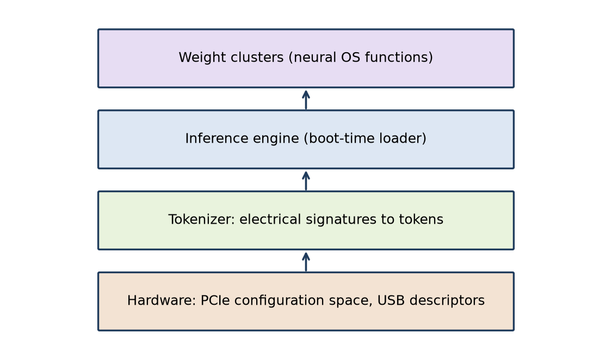
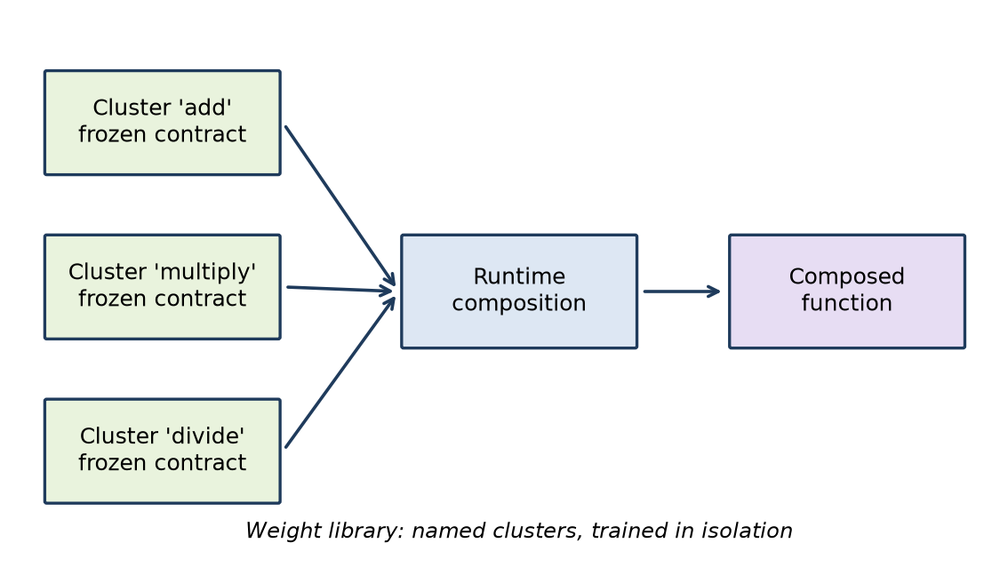
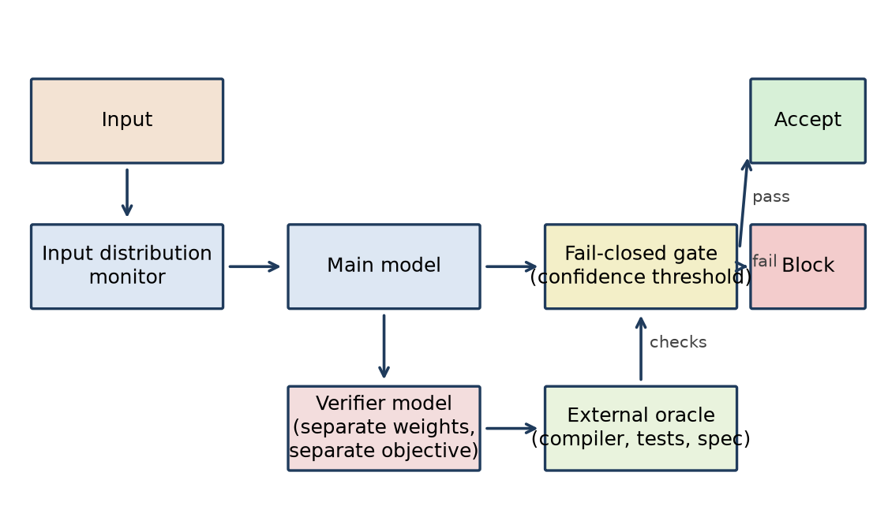
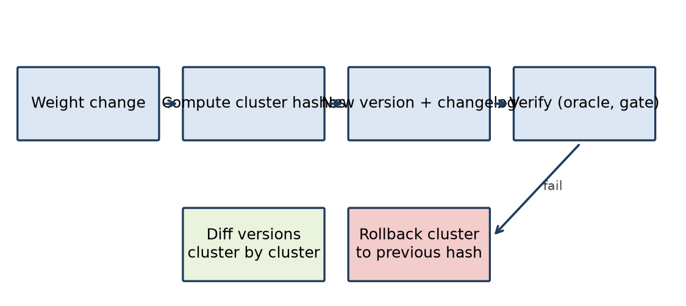
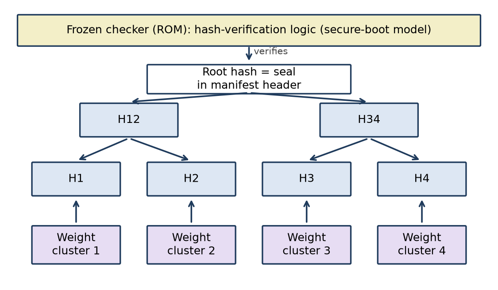

# Weight-Native Computing Architecture: Design Report

**Date:** 2026-10-16  
**Authors:** Shivam Agarwal and Grok (Leo)  
**Context:** Voice design discussion on 2026-10-16

## शीर्षक पृष्ठ (Hindi title page)

**भार-आधारित कंप्यूटिंग संरचना: डिज़ाइन रिपोर्ट**

भार-आधारित ऑपरेटिंग सिस्टम पर चर्चा का औपचारिक अभिलेख  
दिनांक: 2026-10-16  
लेखक: शिवम अग्रवाल और ग्रोक (लियो)  
संदर्भ: 2026-10-16 को हुई मौखिक डिज़ाइन चर्चा

## Front Matter Notes

- Context: This report records a voice design discussion on 2026-10-16.
- Source: No transcript exists. The authors reconstructed this report from the discussion outline.
- The report contains no quotes, metrics, benchmarks, or citations from the discussion.
- Numbering: Sections 9 to 12 are not used in this record. The section numbers follow the discussion outline.
- Style: The text uses ASD-STE100-style controlled technical English at about 80% stringency.

## Abstract

This report records a design discussion about a weight-native computing architecture. In this architecture, model weights replace executable code as the primary artifact. The report translates software engineering invariants into weight space. It describes a neural operating system that detects devices from tokenized electrical signatures. It describes weight libraries that the designer trains in isolation and composes at runtime. It requires an external oracle for verification and a fail-closed gate at runtime. It specifies hash-driven versioning and a Merkle tree over weight clusters in a frozen read-only hash region. It lists the design decisions, the open issues, and the next steps.

## Glossary

| Term | Definition |
|---|---|
| Weight cluster | A named group of model weights that implements one function. |
| Weight library | A set of weight clusters with frozen contracts. |
| Frozen contract | The fixed input and output behavior of a weight cluster. Training does not change it. |
| Composition | The connection of weight clusters at runtime to make a larger function. |
| Inference engine | The program that runs the weights. In the neural OS, it is the boot-time loader. |
| Neural OS | An operating system that the weights implement, not executable code. |
| Electrical signature | The data that a device supplies to the host, for example PCIe configuration space or USB descriptors. |
| Token | One unit of input to the model. |
| Oracle | An external checker of output, for example a compiler, a test suite, or a formal specification. |
| Verifier model | A separate model with separate weights and a separate objective. It checks the output of the main model. |
| Fail-closed gate | A runtime check that blocks the output when a check fails. |
| Confidence threshold | The minimum confidence value that the gate accepts. |
| Input distribution monitor | A runtime check that detects input outside the training distribution. |
| Hash | A fixed-length digest of the weight bytes. |
| Frozen hash region | A read-only memory region that keeps the reference hashes. It follows the secure-boot ROM model. |
| Merkle tree | A tree of hashes. Each leaf is the hash of one weight cluster. Each parent is the hash of its children. |
| Activation probe | A read-only tap on the activations at a cluster boundary. |
| Activation trace | The recorded activations of one run. It is the analog of a stack trace. |

## 1. Motivation and Core Thesis

### 1.1 Core thesis

Model weights replace executable code as the primary artifact. The designer does not write a program. The designer trains, composes, and verifies weights. The system runs weights in an inference engine.

### 1.2 Invariants in weight space

Software engineering has invariants. Examples are modularity, contracts, versioning, verification, and debugging. This report translates each invariant into weight space. Each later section treats one invariant.

## 2. From Code to Weights

### 2.1 Constrained decoding

The first step uses a model to generate code. Constrained decoding limits the output to valid tokens of a grammar. The output is still code. A compiler or an interpreter still runs it.

### 2.2 End-to-end trained code models

The next step trains a model end to end on code tasks. The model produces the result directly or through code. This step moves more of the behavior into the weights.

### 2.3 Weights as data, not program

In the target design, weights are data. The inference engine is the only program. A change of behavior is a change of data. It is not a change of code.

### 2.4 VM-as-weights variant

A variant puts a virtual machine into the weights. The weights then interpret a program, as a VM interprets bytecode. This variant keeps a program layer inside the weight space.

## 3. Neural OS Architecture

### 3.1 Weights as OS

The weights implement the operating system functions. The inference engine is the only executable code on the device.

*Figure 1. Neural OS stack: hardware signatures to tokenizer to inference loader to weight clusters.*

### 3.2 Device detection by electrical signatures

Each device supplies data to the host. Examples are PCIe configuration space and USB descriptors. A tokenizer converts this data into tokens. The model reads the tokens and identifies the device.

### 3.3 Inference engine as boot-time loader

At boot, the inference engine loads the weights. The inference engine then runs the weights as the OS.

### 3.4 Identity as a learned function

Today, a device stores its identity in EEPROM. In this design, device identity becomes a learned function of the signature. The model learns the map from signature to device class.

## 4. Weight Libraries and Composition

### 4.1 Isolated training of function clusters

The designer trains each function cluster in isolation. Examples are clusters for add, multiply, and divide. Isolated training keeps each cluster independent of the others.

*Figure 2. Weight-library composition of frozen, named clusters.*

### 4.2 Frozen contracts and named clusters

After training, the designer freezes the cluster. The frozen contract defines the input and output behavior. Each cluster has a name. The name identifies the cluster in the library.

### 4.3 Runtime composition

At runtime, the system connects clusters to make larger functions. Composition is the weight-space analog of a function call.

### 4.4 Layer classification as design-time contract

The designer assigns a role to each layer at design time. Mechanistic interpretability methods check that the layer performs that role. The role is part of the contract.

### 4.5 Variable-length inputs

Inputs can have different lengths. Attention masks and padding handle variable-length inputs.

### 4.6 Learned type system

The system does not declare types. The weights learn the types from the training data.

## 5. FPGA Analogy

### 5.1 LUT configuration and weight swap

An FPGA keeps its function in LUT configuration memory. A change of configuration changes the function. The hardware stays the same. In this design, a weight swap changes the function. The inference engine stays the same.

### 5.2 Modularity

FPGA designs use modules with fixed interfaces. Weight clusters with frozen contracts are the analog of these modules.

### 5.3 Precision and generalization

A LUT gives an exact result for each input. Weights generalize to new inputs, but they are not exact. The designer must select a point between precision and generalization.

## 6. Verification and Error Handling

### 6.1 External oracle

Verification requires an external oracle. Examples are a compiler, a test suite, and a formal specification.

*Figure 3. Verifier and oracle loop with a fail-closed gate.*

### 6.2 Self-verification

A model that checks its own output only confirms itself. Self-verification is self-confirmation. It is not verification.

### 6.3 Adversarial verifier model

A verifier model has separate weights. It also has a separate objective. Its objective is to find errors in the main model output.

### 6.4 Zero-one loss limits

Many functions have a correct answer or a wrong answer. Zero-one loss gives no gradient. Training on it directly is not possible. The training must use a surrogate loss. The surrogate does not guarantee exact results.

### 6.5 Confidence thresholds

Each output has a confidence value. The gate rejects output below the confidence threshold.

### 6.6 Fail-closed runtime gates

The gate blocks output when a check fails. The system does not pass unchecked output to the next stage.

### 6.7 Input distribution monitors

The monitor compares each input with the training distribution. The monitor flags input outside the distribution. The gate then blocks it.

## 7. Versioning

### 7.1 Hash-driven auto-versioning

The system computes a hash of the weights. A change of weights changes the hash. The new hash creates a new version automatically.

*Figure 5. Versioning and rollback flow.*

### 7.2 Cluster-level granularity

The system computes one hash for each weight cluster. A version then identifies which clusters changed.

### 7.3 Loss of semantic meaning

A hash shows that the weights changed. A hash does not show what the change means.

### 7.4 Cluster-level changelogs

Each cluster has a changelog. The changelog records the reason and the expected effect of each change.

## 8. Self-Referencing Hash Layer

### 8.1 Embedded hash layer

One proposal embeds a hash layer in the weights. The hash layer acts as an integrity seal.

### 8.2 Atomic recompute race

A weight change and the hash recompute are two steps. Between the two steps, the seal is wrong. The update must be atomic to remove this race.

### 8.3 Fixed-point problem

The hash layer is part of the weights. The hash must therefore include its own value. This is a fixed-point problem. A normal hash function cannot solve it.

### 8.4 Frozen read-only hash region

The solution moves the hashes out of the weights. A separate frozen read-only region keeps the reference hashes. This follows the secure-boot ROM model.

*Figure 4. Merkle tree over weight clusters with a frozen ROM hash region.*

### 8.5 Merkle tree over weight clusters

A Merkle tree has one leaf for each weight cluster. The system can verify one cluster without a check of all weights. Git and blockchains use the same structure.

## 13. Debugging

### 13.1 Activation probes

The designer puts activation probes at cluster boundaries. A probe reads the activations. It does not change them.

### 13.2 Circuit tracing

Circuit tracing follows a computation through the model, in the style of Anthropic interpretability work. It shows which components produce an output.

### 13.3 Hash-based rollback and diff

Cluster hashes identify the changed clusters. The designer can roll back one cluster to a previous version. The designer can compare two versions cluster by cluster.

### 13.4 Activation trace

An activation trace records the activations of one run. It is the analog of a stack trace.

## 14. Remaining Open Issues

### 14.1 Security

Adversarial inputs can cause wrong output. Training-data poisoning puts wrong behavior into the weights. A hash cannot catch poisoning. The hash seals the poisoned weights as valid.

### 14.2 Testing

Differential testing compares two implementations on the same inputs. Property-based testing checks properties on random inputs. For weights, the result is a probabilistic bound. Line coverage has no meaning for weights. Statistical coverage of the input space replaces it.

### 14.3 Tooling ecosystem

Code has an IDE, a debugger, and a profiler. Weight-native systems need analog tools. These tools do not exist yet in a complete form.

## 15. Design Decisions Log

Each entry records what was decided, why, the positives, the negatives, and the effect on the program.

### D1. Weights replace code as the primary artifact.

- **Why:** Behavior becomes data that training can change.
- **Positives:** One artifact type. Composition and swap become data operations.
- **Negatives:** Results are not exact. Verification becomes harder.
- **Effect on the program:** All later sections follow from this decision.

### D2. The inference engine is the only executable program and the boot-time loader.

- **Why:** It makes the trusted code base small.
- **Positives:** Small code base to audit.
- **Negatives:** The engine becomes a single point of failure.
- **Effect on the program:** Security work concentrates on the engine and the weights.

### D3. Device detection uses tokenized electrical signatures.

- **Why:** Device data already exists in PCIe configuration space and USB descriptors.
- **Positives:** No separate driver code for identification.
- **Negatives:** Identification can be wrong for unknown devices.
- **Effect on the program:** The OS needs an input distribution monitor for device data.

### D4. Function clusters are trained in isolation and frozen.

- **Why:** Isolation keeps contracts stable.
- **Positives:** Clusters are reusable and independent.
- **Negatives:** Isolated clusters can fail when composed.
- **Effect on the program:** Composition needs its own verification.

### D5. Types are learned, not declared.

- **Why:** The weights learn the structure of the data.
- **Positives:** No type declarations to maintain.
- **Negatives:** No static type check exists.
- **Effect on the program:** Type errors appear only at runtime or in tests.

### D6. Verification uses an external oracle and a separate verifier model.

- **Why:** Self-verification is only self-confirmation.
- **Positives:** Independent checks catch errors that the main model hides.
- **Negatives:** More models and more cost.
- **Effect on the program:** Every release needs oracle results.

### D7. Runtime gates fail closed.

- **Why:** Unchecked output must not reach the next stage.
- **Positives:** Errors stop at the gate.
- **Negatives:** More rejected output. Lower availability.
- **Effect on the program:** The program needs a fallback path for rejected output.

### D8. Versions are hash-driven at cluster level, with changelogs.

- **Why:** A hash detects every weight change.
- **Positives:** Automatic and exact change detection.
- **Negatives:** The hash has no semantic meaning.
- **Effect on the program:** Changelogs are mandatory for each cluster change.

### D9. Reference hashes stay in a frozen read-only region, in a Merkle tree.

- **Why:** An embedded hash layer has a race and a fixed-point problem.
- **Positives:** No self-reference. Partial verification is possible.
- **Negatives:** The ROM region needs a separate update process.
- **Effect on the program:** The boot process verifies the root hash first.

### D10. Debugging uses activation probes, circuit tracing, and hash-based rollback.

- **Why:** No source code exists to step through.
- **Positives:** Visibility at cluster boundaries.
- **Negatives:** Probes show values, not reasons.
- **Effect on the program:** The tooling work needs interpretability methods.

## 16. Open Questions and Next Steps

1. Define the tokenizer format for PCIe configuration space and USB descriptors.
2. Train a small cluster library for add, multiply, and divide. Freeze the contracts.
3. Measure the composition error when clusters connect at runtime.
4. Select an oracle for each cluster: a test suite or a formal specification.
5. Design the verifier model objective.
6. Specify the frozen hash region and the Merkle tree layout.
7. Specify the update process for the frozen hash region.
8. Define the changelog format for each cluster.
9. Open question: how can a design detect training-data poisoning that a hash cannot catch?
10. Open question: which statistical coverage metric replaces line coverage?
11. Open question: which point between precision and generalization suits each function?
12. Open question: which tools replace the IDE, the debugger, and the profiler?

## 17. Input Poisoning vs Weight Poisoning

### 17.1 What the hash protects

The hash protects weight integrity. If the bytes do not change, the hash matches. A hash match shows that the weights are correct.

### 17.2 Input poisoning with correct weights

Input poisoning is possible even with correct weights. An attacker crafts inputs outside the training distribution. These inputs cause wrong outputs. The system does not crash. The hash cannot detect this attack.

### 17.3 Defense

Runtime input distribution monitors are the defense. Confidence thresholds are also part of the defense.

### 17.4 Two separate layers

The design uses two separate layers. The hash guards the weights. The input gate guards the model.

## 18. Type-Confusion and Error-Raising Clusters

### 18.1 Type-confusion attack

Addition of a float and a string is a type-confusion attack.

### 18.2 Error-raising clusters

Train clusters to emit error tokens or machine code on incompatible inputs. Example: train the add cluster to reject string plus float.

### 18.3 Confidence rule

The model can show low confidence when it handles an input. If the confidence or probability drops below 50%, the cluster emits an error code. This rule is fail-closed. The cluster does not guess.

### 18.4 Drift of the error boundary

The error boundary itself is a learned surface. A learned surface can drift. Drift causes false rejects and false accepts. Thus the error boundary still needs pinning.

## 19. Frozen Checker

### 19.1 Definition

The frozen checker is a small, handwritten, deterministic program. It stays outside the weights. It is not weight-based. Weights are probabilistic. A safety gate cannot tolerate even 1% error.

### 19.2 Location and boot order

The frozen checker is hosted in ROM or in a signed firmware image. It executes before the weights load. This order is like BIOS or secure boot.

### 19.3 Build

The checker is written in C. The compiler compiles it at build time to a tiny binary. The source is about 20-30 lines. The binary is about 1-4 KB. No GCC exists at runtime.

### 19.4 Runtime steps

1. Read the input token.
2. Match the token against the expected type.
3. On mismatch, set the error flag.
4. On match, pass the token to the weights.

## 20. Weight-Native Kernel Size Estimate

### 20.1 Cluster sizes

The table gives the size of one cluster at four scales. Sizes are for FP16.

| Cluster | Layers | Model dim (d) | FF dim | Parameters | Size (FP16) |
|---|---|---|---|---|---|
| Tiny | 2 | 256 | 512 | 17.4M | 35 MB |
| Small | 4 | 512 | 1024 | 41.2M | 82 MB |
| Medium | 8 | 768 | 2048 | 93.2M | 186 MB |
| Large | 12 | 1024 | 4096 | 216.5M | 433 MB |

### 20.2 Full OS estimate

The estimate uses 8 OS services. Each service is one tiny cluster.

| Configuration | Parameters | FP16 | FP8 | 4-bit |
|---|---|---|---|---|
| 8 OS services x tiny cluster | 139M | 279 MB | 139 MB | 70 MB |

### 20.3 Comparison with code kernels

| System | Source size | Compiled size |
|---|---|---|
| Linux kernel v6.x | ~30M LOC | 10-20 MB |
| xv6-like minimal kernel | ~10K LOC | ~1 MB |
| Frozen checker | ~20-30 lines | ~1-4 KB |

### 20.4 Trade-off

Storage is 10-100x heavier. Code complexity is near zero.

### 20.5 Third dimension: debugging

Debugging complexity does not disappear. It moves into the weights. Engineers read activation traces instead of stack traces.

## 21. Activation Breakpoints and Debugging

### 21.1 Activation breakpoint

An activation breakpoint halts the forward pass at a cluster. The granularity is coarse compared to instruction-level breakpoints. But the full state is visible: input, output, and weight values. This is like registers and locals in gdb.

### 21.2 Replay

The real difficulty is replay, not stepping. Randomness and accumulated state make replay hard.

### 21.3 Binary search debugging

Halt at a layer. If the output is correct, the bug is in the forward layers. If the output is wrong, the bug is in the backward layers. Repeat to narrow down the bug.

### 21.4 Debugger cluster

A dedicated debugger cluster receives the activation outputs. It does per-layer logging. It does context-aware logging. Context-aware logging records which context has which activation.

### 21.5 Parallel complexity

Debugging complexity becomes parallel, not sequential. This follows the microservices observability pattern. The pattern uses per-component logs, trace IDs, and narrow-down.

## 22. Cluster Classes and Dynamic Composition

### 22.1 Functions and objects

Primitive clusters are functions. Cluster classes are objects. A cluster class keeps state and behavior in weights.

### 22.2 Instantiation

Instantiation does NOT require new weight snapshots. A Fibonacci class is a routing pattern over the add and store clusters. It is not a set of new weights.

### 22.3 Dispatch weights

Dynamic composition uses dispatch weights, not weight swapping. A small router cluster takes a task, for example Fibonacci. The router outputs a sequence of primitive cluster IDs: add, add, store, loop. Each primitive runs. Its output returns to the router. The router decides the next step.

### 22.4 Call graph in weights

The call graph is encoded in weights. Today's branch instructions become router activations.

### 22.5 Router output

The router outputs structured IDs from a fixed vocabulary. The vocabulary is the cluster registry, like an opcode table. The router is trained on task-to-sequence pairs. The router does not do token generation.

## 23. Weight Manifest Header

### 23.1 Header contents

Today, bytecode is sent with a header. Weights also get a header. The header contains the weight name, the root hash, the layer count, and the per-layer hashes. The header is small: about hundreds of bytes per cluster.

### 23.2 Registry lookup

The router finds clusters by reading headers. It matches the hash or the name. This is a registry lookup. It is the analog of a bytecode import table. The hash enables a direct index. No linear scan is necessary.

### 23.3 Self-verified header

The header is PART of the weight file. A change to the header breaks the hash. Thus the header is self-verified.

### 23.4 Self-referencing hash

1. Set the hash field to zero.
2. Compute the hash.
3. Store the result in the hash field.
To verify, repeat the steps and compare.
Use a length-extension-resistant hash, for example SHA-3.

## 24. Updated Design Decisions Log

This log records the decisions from the later part of the discussion. It extends Section 15.

| ID | Decision | Section |
|---|---|---|
| a | Input gate separate from hash layer | 17 |
| b | Error-raising as trained cluster behavior with 50% confidence threshold | 18 |
| c | Frozen checker in ROM/signed firmware, C-compiled, outside weights | 19 |
| d | Weight-native kernel size trade-off accepted (storage up, code down) | 20 |
| e | Activation breakpoints + binary search + debugger cluster for debugging | 21 |
| f | Dispatch weights for dynamic cluster composition | 22 |
| g | Weight manifest header with self-referencing hash | 23 |

## 25. Open Questions (updated)

These questions add to the open questions in Section 16.

1. Does the frozen checker need its own hash or signing?
2. Can router dispatch weights themselves be versioned and hashed?
3. How can training make error boundaries without false rejects?
4. Can cluster classes share primitive weights (parameter sharing) to reduce the 279 MB footprint?

## Appendix A. Karpathy ASD-STE100 Reference

- Andrej Karpathy posted on X on 2026-10-02 at 00:37 UTC (06:07 IST). URL: https://x.com/karpathy/status/2105819303471976479.
- The X connector returned the start of the post text. The returned text is: "Ask your LLM to explain something in ASD-STE100, it's a controlled language specification originally developed for". The connector truncated the remaining text. The authors did not verify the remaining text.
- The user referenced the advice to aim for about 80% of full ASD-STE100 stringency. The authors did not verify this part against the full post text.
- ASD-STE100 is Simplified Technical English. The aerospace industry developed it for maintenance documentation.
- This report applies these rules: short sentences, active voice, one idea per sentence, and one term for one meaning.
- The glossary defines each term. The text uses each term with the same meaning.
- The report does not apply the full approved-word dictionary. This is the 20% that the report does not apply.

## Appendix B. Idea Inventory

1. Model weights replace executable code as the primary artifact.
2. Software engineering invariants translate into weight space.
3. Constrained decoding limits model output to valid code.
4. End-to-end trained code models move behavior into the weights.
5. Weights are data, not program.
6. A virtual machine can exist as weights (VM-as-weights).
7. The weights implement the operating system.
8. Device detection uses electrical signatures.
9. PCIe configuration space becomes tokens.
10. USB descriptors become tokens.
11. The inference engine is the boot-time loader.
12. EEPROM-stored identity becomes a learned function.
13. Function clusters are trained in isolation.
14. Example clusters are add, multiply, and divide.
15. Clusters have frozen contracts.
16. Clusters have names.
17. Clusters compose at runtime.
18. Layer classification is a design-time contract.
19. Mechanistic interpretability checks layer roles.
20. Attention masks and padding handle variable-length inputs.
21. The type system is learned, not declared.
22. FPGA LUT configuration memory is the analog of a weight swap.
23. Modularity follows the FPGA module model.
24. A tradeoff exists between precision and generalization.
25. Verification requires an external oracle.
26. Oracle examples are a compiler, a test suite, and a formal specification.
27. Self-verification is self-confirmation.
28. An adversarial verifier model has separate weights.
29. The verifier model has a separate objective.
30. Zero-one loss limits training for exact functions.
31. Confidence thresholds control output acceptance.
32. Runtime gates fail closed.
33. Input distribution monitors detect out-of-distribution input.
34. A weight change triggers hash-driven auto-versioning.
35. Versioning has cluster-level granularity.
36. Hash versions lose semantic meaning.
37. Each cluster has a changelog.
38. An embedded hash layer acts as an integrity seal.
39. The embedded hash has an atomic recompute race.
40. The embedded hash has a fixed-point problem.
41. A separate frozen read-only hash region solves the problem (secure-boot ROM model).
42. A Merkle tree over weight clusters gives partial verification.
43. The Merkle tree is the analog of Git and blockchain structures.
44. Activation probes sit at cluster boundaries.
45. Circuit tracing in the Anthropic style shows the computation path.
46. Hashes enable rollback and diff.
47. An activation trace is the analog of a stack trace.
48. Adversarial inputs are a security issue.
49. A hash cannot catch training-data poisoning.
50. Differential testing compares implementations.
51. Property-based testing gives probabilistic bounds.
52. Statistical coverage replaces line coverage.
53. The ecosystem needs IDE, debugger, and profiler analogs.
54. Each design decision records what, why, positives, negatives, and effect on the program.
