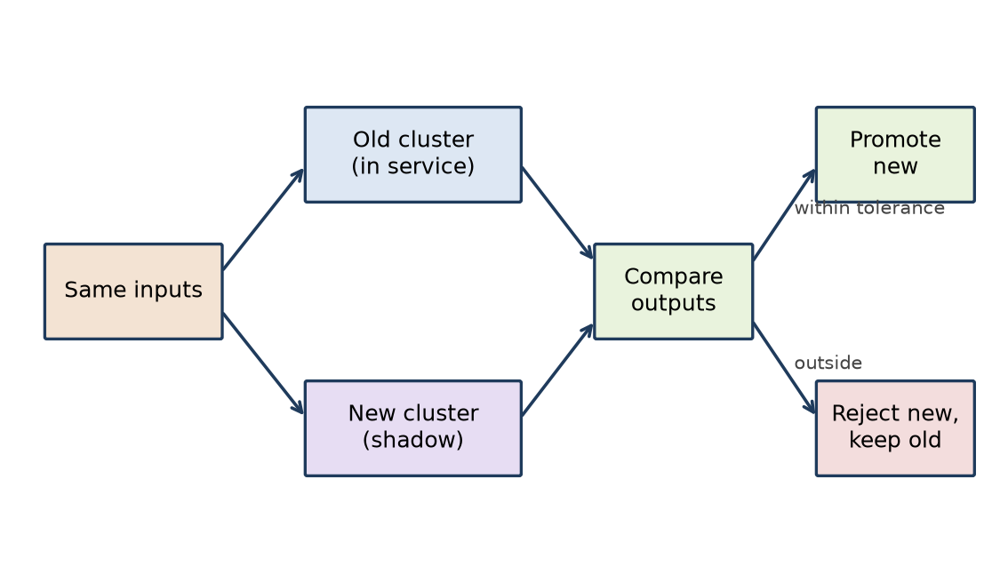

# Weight-Native Computing Architecture: Design Report

**Date:** 2026-10-16  
**Authors:** Shivam Agarwal and Grok (Leo)  
**Context:** Voice design discussion on 2026-10-16

## शीर्षक पृष्ठ (Hindi title page)

**भार-आधारित कंप्यूटिंग संरचना: डिज़ाइन रिपोर्ट**

भार-आधारित ऑपरेटिंग सिस्टम पर चर्चा का औपचारिक अभिलेख  
दिनांक: 2026-10-16  
लेखक: शिवम अग्रवाल और ग्रोक (लियो)  
संदर्भ: 2026-10-16 को हुई मौखिक डिज़ाइन चर्चा

## Front Matter Notes

- Context: This report records a voice design discussion on 2026-10-16.
- Source: No transcript exists. The authors reconstructed this report from the discussion outline.
- The report contains no quotes or benchmarks from the discussion.
- Section 20 contains size estimates from the discussion. They are estimates, not measurements.
- The prior-work note cites published research. The authors added these citations after the discussion. The discussion did not cite them.
- Sections 17 to 31 record the later part of the same discussion. A quality pass added the assumptions, the prior-work note, the extended glossary, and Section 32.
- Numbering: Sections 9 to 12 are not used in this record. The section numbers follow the discussion outline.
- Style: The text uses ASD-STE100-style controlled technical English at about 80% stringency.

## Abstract

This report records a design discussion about a weight-native computing architecture. In this architecture, model weights replace executable code as the primary artifact. The report translates software engineering invariants into weight space. It describes a neural operating system that detects devices from tokenized electrical signatures. It describes weight libraries that the designer trains in isolation and composes at runtime. It requires an external oracle for verification and a fail-closed gate at runtime. It specifies hash-driven versioning and a Merkle tree over weight clusters in a frozen read-only hash region. The later sections add an input gate, error-raising clusters, a frozen checker, size estimates, activation debugging, router-based composition, manifest headers, a delta store, capability tokens, shadow execution, and a dev and production test split. It lists the design decisions, the open issues, and the next steps.

## Assumptions and Limitations

- (a) This report is a design proposal. It is not an implemented system.
- (b) No trained weight clusters exist yet. All cluster behavior in this report is hypothetical.
- (c) Outputs are probabilistic. Thus zero-one loss cannot be used at runtime without an external oracle (Sections 6.1 and 6.4).
- (d) Storage cost is 10-100x that of a code kernel (Section 20.4).
- (e) The router and dispatch vocabulary is a fixed registry. The system does not learn it at runtime (Section 22.5).

## How This Differs from Existing Work

Research has explored weight-based execution, neural networks that act as machines, and learned dispatch. Examples are neural program induction and differentiable interpreters. Neural Turing Machines couple a neural network to an external memory (Graves, Wayne, and Danihelka, 2014, arXiv:1410.5401). Neural Programmer-Interpreters learn to call and compose sub-programs (Reed and de Freitas, ICLR 2016, arXiv:1511.06279). A differentiable Forth interpreter lets a programmer write a program sketch with slots that training fills (Bošnjak, Rocktäschel, Naradowsky, and Riedel, ICML 2017, arXiv:1605.06640). Sparsely-gated mixture-of-experts layers use a learned gate to route each input to expert sub-networks (Shazeer et al., ICLR 2017, arXiv:1701.06538). Capability-based security comes from operating systems such as seL4 (Klein et al., SOSP 2009) and Capsicum (Watson et al., USENIX Security 2010). This report combines isolated trained clusters, a frozen external checker, capability tokens, shadow execution, and a self-referencing hash into one full OS replacement. To the knowledge of the authors, no earlier work documents this combination as a coherent system design. The authors did not do a systematic literature search. This statement is therefore a limitation, not a proof of novelty.

## Glossary

| Term | Definition |
|---|---|
| Cluster (weight cluster) | A named group of model weights that implements one function (Sections 4.1 and 4.2). |
| Primitive cluster | A cluster that implements one basic function, for example add or store. It is the analog of a function (Section 22.1). |
| Higher-order cluster | A function that the router makes from primitive clusters in sequence. The report also calls it a cluster class. It needs no new weights (Section 22.2). |
| Router | A small cluster that takes a task and outputs a sequence of primitive cluster IDs from the cluster registry (Sections 22.3 to 22.5). |
| Dispatch weights | The router weights that encode the call graph (Section 22.4). |
| Cluster registry | The fixed vocabulary of cluster IDs that the router can output. It is the analog of an opcode table (Section 22.5). |
| Capability token | A signed declaration that ships with a cluster. It declares the input types, the output types, the resource limits, and the shadow-execution tolerance (Section 27). |
| Delta store | A store that keeps only the differences between weight versions. The hash always covers the full assembled artifact (Section 26). |
| Shadow execution | A run of a new cluster version in parallel with the old version on the same inputs, before promotion (Section 28). |
| Frozen checker | A small handwritten deterministic C program in ROM or in a signed firmware image. It runs before the weights load and holds the hash-verification logic (Sections 8.4 and 19). |
| Manifest header | The part of the weight file that holds the weight name, the root hash, the layer count, and the per-layer hashes (Sections 23 and 31). |
| Self-referencing hash | A hash field inside the weight artifact. The system sets the field to zero, computes the hash, and stores it in the field (Section 31.2). |
| Weight ID | The identity of a weight artifact: its name and its root hash in the manifest header. The router uses it for registry lookup (Section 23.2). |
| Error boundary | The learned surface where a cluster changes from a result to an error code (Section 18.4). |
| Golden input set | A set of known input-output pairs that humans verify (Section 29.2). |
| Binary-search debugging | A method that halts the forward pass at a layer or cluster boundary and checks the output. Each check halves the region that contains the fault (Sections 21.3 and 30.2). |
| Weight library | A set of weight clusters with frozen contracts. |
| Frozen contract | The fixed input and output behavior of a weight cluster. Training does not change it. |
| Composition | The connection of weight clusters at runtime to make a larger function. |
| Inference engine | The program that runs the weights. In the neural OS, it is the boot-time loader. |
| Neural OS | An operating system that the weights implement, not executable code. |
| Electrical signature | The data that a device supplies to the host, for example PCIe configuration space or USB descriptors. |
| Token | One unit of input to the model. |
| Oracle | An external checker of output, for example a compiler, a test suite, or a formal specification. |
| Verifier model | A separate model with separate weights and a separate objective. It checks the output of the main model. |
| Fail-closed gate | A runtime check that blocks the output when a check fails. |
| Confidence threshold | The minimum confidence value that the gate accepts. |
| Input distribution monitor | A runtime check that detects input outside the training distribution. |
| Hash | A fixed-length digest of the weight bytes. |
| Frozen hash region | A read-only memory region that keeps the reference hashes. It follows the secure-boot ROM model. |
| Merkle tree | A tree of hashes. Each leaf is the hash of one weight cluster. Each parent is the hash of its children. |
| Activation probe | A read-only tap on the activations at a cluster boundary. |
| Activation trace | The recorded activations of one run. It is the analog of a stack trace. |
| Symbolic IR | An intermediate representation that a formal verifier can check before the system lowers it to machine code (Section 33). |
| Intent layer | A small, frozen, deterministic check between the router output and execution. It checks that the cluster-ID sequence is coherent (Section 34). |
| Memory tiering | Hot clusters stay in fast memory. Cold clusters stay in storage (Section 35.3). |
| Provenance residual | The semantic risk that provenance checks cannot remove: correct bytes with wrong learned behavior (Section 36). |

## 1. Motivation and Core Thesis

### 1.1 Core thesis

Model weights replace executable code as the primary artifact. The designer does not write a program. The designer trains, composes, and verifies weights. The system runs weights in an inference engine.

### 1.2 Invariants in weight space

Software engineering has invariants. Examples are modularity, contracts, versioning, verification, and debugging. This report translates each invariant into weight space. Each later section treats one invariant.

## 2. From Code to Weights

### 2.1 Constrained decoding

The first step uses a model to generate code. Constrained decoding limits the output to valid tokens of a grammar. The output is still code. A compiler or an interpreter still runs it.

### 2.2 End-to-end trained code models

The next step trains a model end to end on code tasks. The model produces the result directly or through code. This step moves more of the behavior into the weights.

### 2.3 Weights as data, not program

In the target design, weights are data. The inference engine is the only general program. A change of behavior is a change of data. It is not a change of code. Section 19 adds one more small fixed program: the frozen checker.

### 2.4 VM-as-weights variant

A variant puts a virtual machine into the weights. The weights then interpret a program, as a VM interprets bytecode. This variant keeps a program layer inside the weight space.

## 3. Neural OS Architecture

### 3.1 Weights as OS

The weights implement the operating system functions. The inference engine is the only general executable code on the device. The frozen checker of Section 19 is a second, small, fixed program. It runs before the weights load.

*Figure 1. Neural OS stack: hardware signatures to tokenizer to inference loader to weight clusters.*

### 3.2 Device detection by electrical signatures

Each device supplies data to the host. Examples are PCIe configuration space and USB descriptors. A tokenizer converts this data into tokens. The model reads the tokens and identifies the device.

### 3.3 Inference engine as boot-time loader

At boot, the inference engine loads the weights. The inference engine then runs the weights as the OS.

### 3.4 Identity as a learned function

Today, a device stores its identity in EEPROM. In this design, device identity becomes a learned function of the signature. The model learns the map from signature to device class.

## 4. Weight Libraries and Composition

### 4.1 Isolated training of function clusters

The designer trains each function cluster in isolation. Examples are clusters for add, multiply, and divide. Isolated training keeps each cluster independent of the others.

*Figure 2. Weight-library composition of frozen, named clusters.*

### 4.2 Frozen contracts and named clusters

After training, the designer freezes the cluster. The frozen contract defines the input and output behavior. Each cluster has a name. The name identifies the cluster in the library.

### 4.3 Runtime composition

At runtime, the system connects clusters to make larger functions. Composition is the weight-space analog of a function call.

### 4.4 Layer classification as design-time contract

The designer assigns a role to each layer at design time. Mechanistic interpretability methods check that the layer performs that role. The role is part of the contract.

### 4.5 Variable-length inputs

Inputs can have different lengths. Attention masks and padding handle variable-length inputs.

### 4.6 Learned type system

The system does not declare types. The weights learn the types from the training data.

## 5. FPGA Analogy

### 5.1 LUT configuration and weight swap

An FPGA keeps its function in LUT configuration memory. A change of configuration changes the function. The hardware stays the same. In this design, a weight swap changes the function. The inference engine stays the same.

### 5.2 Modularity

FPGA designs use modules with fixed interfaces. Weight clusters with frozen contracts are the analog of these modules.

### 5.3 Precision and generalization

A LUT gives an exact result for each input. Weights generalize to new inputs, but they are not exact. The designer must select a point between precision and generalization.

## 6. Verification and Error Handling

### 6.1 External oracle

Verification requires an external oracle. Examples are a compiler, a test suite, and a formal specification.

*Figure 3. Verifier and oracle loop with a fail-closed gate.*

### 6.2 Self-verification

A model that checks its own output only confirms itself. Self-verification is self-confirmation. It is not verification.

### 6.3 Adversarial verifier model

A verifier model has separate weights. It also has a separate objective. Its objective is to find errors in the main model output.

### 6.4 Zero-one loss limits

Many functions have a correct answer or a wrong answer. Zero-one loss gives no gradient. Training on it directly is not possible. The training must use a surrogate loss. The surrogate does not guarantee exact results.

### 6.5 Confidence thresholds

Each output has a confidence value. The gate rejects output below the confidence threshold. Section 18.3 sets the threshold at 50% for error-raising clusters.

### 6.6 Fail-closed runtime gates

The gate blocks output when a check fails. The system does not pass unchecked output to the next stage.

### 6.7 Input distribution monitors

The monitor compares each input with the training distribution. The monitor flags input outside the distribution. The gate then blocks it. Section 17 makes this input gate a layer separate from the hash.

## 7. Versioning

### 7.1 Hash-driven auto-versioning

The system computes a hash of the weights. A change of weights changes the hash. The new hash creates a new version automatically. Section 26 stores versions as deltas. The hash always covers the full assembled artifact.

*Figure 5. Versioning and rollback flow.*

### 7.2 Cluster-level granularity

The system computes one hash for each weight cluster. A version then identifies which clusters changed.

### 7.3 Loss of semantic meaning

A hash shows that the weights changed. A hash does not show what the change means.

### 7.4 Cluster-level changelogs

Each cluster has a changelog. The changelog records the reason and the expected effect of each change.

## 8. Self-Referencing Hash Layer

### 8.1 Embedded hash layer

One proposal embeds a hash layer in the weights. The hash layer acts as an integrity seal. Sections 8.1 to 8.3 record this first proposal and its problems. Section 8.4 gives the resolution.

### 8.2 Atomic recompute race

A weight change and the hash recompute are two steps. Between the two steps, the seal is wrong. The update must be atomic to remove this race.

### 8.3 Fixed-point problem

The hash layer is part of the weights. The hash must therefore include its own value. This is a fixed-point problem. A normal hash function cannot solve it directly. Section 31.2 removes the problem: the system sets the hash field to zero before it computes the hash.

### 8.4 Resolution: the ROM verifies, the artifact carries its own seal

The frozen checker in ROM holds the hash-verification logic (Section 19). The self-referencing hash field lives inside the weight artifact, in the manifest header (Sections 23 and 31). The ROM verifies. The artifact carries its own seal. This follows the secure-boot ROM model. Zeroing the hash field before computation removes the fixed-point problem of Section 8.3. The atomic recompute race of Section 8.2 still applies. An update must write the weights and the seal in one atomic step. Limitation: a self-seal shows that the bytes are consistent. It does not show that an approved party made them. The signed header of Section 31.5 gives this proof. The location of the trusted reference, for example a public key or a Merkle root, is UNDECIDED (Section 25).

*Figure 4. Merkle tree over weight clusters. The frozen checker in ROM verifies the seals. The seal lives in the artifact.*

### 8.5 Merkle tree over weight clusters

A Merkle tree has one leaf for each weight cluster. The system can verify one cluster without a check of all weights. Git and blockchains use the same structure. The per-layer hashes in the manifest header (Section 23.1) are the leaves inside one cluster.

## 13. Debugging

### 13.1 Activation probes

The designer puts activation probes at cluster boundaries. A probe reads the activations. It does not change them.

### 13.2 Circuit tracing

Circuit tracing follows a computation through the model, in the style of Anthropic interpretability work. It shows which components produce an output.

### 13.3 Hash-based rollback and diff

Cluster hashes identify the changed clusters. The designer can roll back one cluster to a previous version. The designer can compare two versions cluster by cluster. Section 26 makes rollback a delta operation.

### 13.4 Activation trace

An activation trace records the activations of one run. It is the analog of a stack trace. Sections 21 and 30 refine debugging with activation breakpoints, binary search, and a debugger cluster.

## 14. Remaining Open Issues

### 14.1 Security

Adversarial inputs can cause wrong output. Training-data poisoning puts wrong behavior into the weights. A hash cannot catch poisoning. The hash seals the poisoned weights as valid. Section 17 treats input poisoning. Training-data poisoning stays open (Section 16).

### 14.2 Testing

Differential testing compares two implementations on the same inputs. Property-based testing checks properties on random inputs. For weights, the result is a probabilistic bound. Line coverage has no meaning for weights. Statistical coverage of the input space replaces it. Section 29 assigns these methods to the dev and production environments.

### 14.3 Tooling ecosystem

Code has an IDE, a debugger, and a profiler. Weight-native systems need analog tools. These tools do not exist yet in a complete form. Sections 21 and 30 define the debugger approach.

## 15. Design Decisions Log

Each entry records what was decided, why, the positives, the negatives, and the effect on the program.

### D1. Weights replace code as the primary artifact.

- **Why:** Behavior becomes data that training can change.
- **Positives:** One artifact type. Composition and swap become data operations.
- **Negatives:** Results are not exact. Verification becomes harder.
- **Effect on the program:** All later sections follow from this decision.

### D2. The inference engine is the only general executable program and the boot-time loader.

- **Why:** It makes the trusted code base small.
- **Positives:** Small code base to audit.
- **Negatives:** The engine becomes a single point of failure.
- **Effect on the program:** Security work concentrates on the engine and the weights. Decision (c) adds the frozen checker to the trusted code base.

### D3. Device detection uses tokenized electrical signatures.

- **Why:** Device data already exists in PCIe configuration space and USB descriptors.
- **Positives:** No separate driver code for identification.
- **Negatives:** Identification can be wrong for unknown devices.
- **Effect on the program:** The OS needs an input distribution monitor for device data.

### D4. Function clusters are trained in isolation and frozen.

- **Why:** Isolation keeps contracts stable.
- **Positives:** Clusters are reusable and independent.
- **Negatives:** Isolated clusters can fail when composed.
- **Effect on the program:** Composition needs its own verification.

### D5. Types are learned, not declared.

- **Why:** The weights learn the structure of the data.
- **Positives:** No type declarations to maintain.
- **Negatives:** No static type check exists.
- **Effect on the program:** Type errors appear only at runtime or in tests.

### D6. Verification uses an external oracle and a separate verifier model.

- **Why:** Self-verification is only self-confirmation.
- **Positives:** Independent checks catch errors that the main model hides.
- **Negatives:** More models and more cost.
- **Effect on the program:** Every release needs oracle results.

### D7. Runtime gates fail closed.

- **Why:** Unchecked output must not reach the next stage.
- **Positives:** Errors stop at the gate.
- **Negatives:** More rejected output. Lower availability.
- **Effect on the program:** The program needs a fallback path for rejected output.

### D8. Versions are hash-driven at cluster level, with changelogs.

- **Why:** A hash detects every weight change.
- **Positives:** Automatic and exact change detection.
- **Negatives:** The hash has no semantic meaning.
- **Effect on the program:** Changelogs are mandatory for each cluster change.

### D9. The frozen checker in ROM holds the hash-verification logic. Each artifact carries its own self-referencing seal. Cluster hashes form a Merkle tree.

- **Why:** Logic in ROM cannot change at runtime. Zeroing the hash field removes the fixed-point problem (Section 31.2).
- **Positives:** Partial verification is possible. Each file verifies itself.
- **Negatives:** The atomic recompute race remains. The ROM needs a separate update process. A self-seal alone does not prove authenticity.
- **Effect on the program:** The boot process runs the frozen checker first. See Sections 8.4, 19, and 31. This entry replaces the earlier text that moved all hashes out of the weights.

### D10. Debugging uses activation probes, circuit tracing, and hash-based rollback.

- **Why:** No source code exists to step through.
- **Positives:** Visibility at cluster boundaries.
- **Negatives:** Probes show values, not reasons.
- **Effect on the program:** The tooling work needs interpretability methods.

## 16. Open Questions and Next Steps

1. Define the tokenizer format for PCIe configuration space and USB descriptors.
2. Train a small cluster library for add, multiply, and divide. Freeze the contracts.
3. Measure the composition error when clusters connect at runtime.
4. Select an oracle for each cluster: a test suite or a formal specification.
5. Design the verifier model objective.
6. Specify the frozen hash region and the Merkle tree layout.
7. Specify the update process for the frozen hash region.
8. Define the changelog format for each cluster.
9. Open question: how can a design detect training-data poisoning that a hash cannot catch? Status: partly answered. Section 17 adds an input gate for input poisoning. Training-data poisoning is UNDECIDED. Why it matters: a hash seals poisoned weights as valid (Section 14.1).
10. Open question: which statistical coverage metric replaces line coverage? Status: UNDECIDED. Why it matters: without a metric, the program cannot say when testing is complete (Sections 14.2 and 29.5).
11. Open question: which point between precision and generalization suits each function? Status: partly answered. Section 18.3 sets a 50% error threshold. Section 28.3 sets tolerance for each cluster in its capability. The point for each function is UNDECIDED. Why it matters: it sets how exact each cluster must be.
12. Open question: which tools replace the IDE, the debugger, and the profiler? Status: partly answered. Sections 21 and 30 define the debugger approach. The IDE and profiler analogs are UNDECIDED. Why it matters: engineers cannot build or tune clusters without them.

## 17. Input Poisoning vs Weight Poisoning

### 17.1 What the hash protects

The hash protects weight integrity. If the bytes do not change, the hash matches. A hash match shows that the weights are correct.

### 17.2 Input poisoning with correct weights

Input poisoning is possible even with correct weights. An attacker crafts inputs outside the training distribution. These inputs cause wrong outputs. The system does not crash. The hash cannot detect this attack.

### 17.3 Defense

Runtime input distribution monitors are the defense. Confidence thresholds are also part of the defense.

### 17.4 Two separate layers

The design uses two separate layers. The hash guards the weights. The input gate guards the model.

## 18. Type-Confusion and Error-Raising Clusters

### 18.1 Type-confusion attack

Addition of a float and a string is a type-confusion attack.

### 18.2 Error-raising clusters

Train clusters to emit error tokens or machine code on incompatible inputs. Example: train the add cluster to reject string plus float.

### 18.3 Confidence rule

The model can show low confidence when it handles an input. If the confidence or probability drops below 50%, the cluster emits an error code. This rule is fail-closed. The cluster does not guess.

### 18.4 Drift of the error boundary

The error boundary itself is a learned surface. A learned surface can drift. Drift causes false rejects and false accepts. Thus the error boundary still needs pinning.

## 19. Frozen Checker

### 19.1 Definition

The frozen checker is a small, handwritten, deterministic program. It stays outside the weights. It is not weight-based. Weights are probabilistic. A safety gate cannot tolerate even 1% error.

### 19.2 Location and boot order

The frozen checker is hosted in ROM or in a signed firmware image. It executes before the weights load. This order is like BIOS or secure boot.

### 19.3 Build

The checker is written in C. The compiler compiles it at build time to a tiny binary. The source is about 20-30 lines. The binary is about 1-4 KB. No GCC exists at runtime.

### 19.4 Runtime steps

1. Read the input token.
2. Match the token against the expected type.
3. On mismatch, set the error flag.
4. On match, pass the token to the weights.

## 20. Weight-Native Kernel Size Estimate

### 20.1 Cluster sizes

The table gives the size of one cluster at four scales. Sizes are for FP16. Assumption: FP16 uses 2 bytes for each parameter, FP8 uses 1 byte, and 4-bit uses 0.5 byte. The stated sizes agree with this. Limitation: the discussion did not record how it derived the parameter counts, for example the vocabulary size or the embedding size. The numbers are estimates, not measurements.

| Cluster | Layers | Model dim (d) | FF dim | Parameters | Size (FP16) |
|---|---|---|---|---|---|
| Tiny | 2 | 256 | 512 | 17.4M | 35 MB |
| Small | 4 | 512 | 1024 | 41.2M | 82 MB |
| Medium | 8 | 768 | 2048 | 93.2M | 186 MB |
| Large | 12 | 1024 | 4096 | 216.5M | 433 MB |

### 20.2 Full OS estimate

The estimate uses 8 OS services. Each service is one tiny cluster.

| Configuration | Parameters | FP16 | FP8 | 4-bit |
|---|---|---|---|---|
| 8 OS services x tiny cluster | 139M | 279 MB | 139 MB | 70 MB |

### 20.3 Comparison with code kernels

| System | Source size | Compiled size |
|---|---|---|
| Linux kernel v6.x | ~30M LOC | 10-20 MB |
| xv6-like minimal kernel | ~10K LOC | ~1 MB |
| Frozen checker | ~20-30 lines | ~1-4 KB |

### 20.4 Trade-off

Storage is 10-100x heavier. Code complexity is near zero.

### 20.5 Third dimension: debugging

Debugging complexity does not disappear. It moves into the weights. Engineers read activation traces instead of stack traces.

## 21. Activation Breakpoints and Debugging

### 21.1 Activation breakpoint

An activation breakpoint halts the forward pass at a cluster. The granularity is coarse compared to instruction-level breakpoints. But the full state is visible: input, output, and weight values. This is like registers and locals in gdb.

### 21.2 Replay

The real difficulty is replay, not stepping. Randomness and accumulated state make replay hard.

### 21.3 Binary search debugging

Halt at a layer. If the output is correct, the bug is in the forward layers, after the halt point. If the output is wrong, the bug is in the backward layers, before the halt point. Repeat to narrow down the bug. Section 30 refines this method.

### 21.4 Debugger cluster

A dedicated debugger cluster receives the activation outputs. It does per-layer logging. It does context-aware logging. Context-aware logging records which context has which activation.

### 21.5 Parallel complexity

Debugging complexity becomes parallel, not sequential. This follows the microservices observability pattern. The pattern uses per-component logs, trace IDs, and narrow-down.

## 22. Cluster Classes and Dynamic Composition

### 22.1 Functions and objects

Primitive clusters are functions. Cluster classes are objects. The glossary also calls them higher-order clusters. A cluster class keeps state and behavior in weights. Its behavior is a routing pattern in the router weights (Section 22.3). The discussion does not state which weights keep the state of a class (Section 25).

### 22.2 Instantiation

Instantiation does NOT require new weight snapshots. A Fibonacci class is a routing pattern over the add and store clusters. It is not a set of new weights.

### 22.3 Dispatch weights

Dynamic composition uses dispatch weights, not weight swapping. A small router cluster takes a task, for example Fibonacci. The router outputs a sequence of primitive cluster IDs: add, add, store, loop. Each primitive runs. Its output returns to the router. The router decides the next step.

### 22.4 Call graph in weights

The call graph is encoded in weights. Today's branch instructions become router activations.

### 22.5 Router output

The router outputs structured IDs from a fixed vocabulary. The vocabulary is the cluster registry, like an opcode table. The router is trained on task-to-sequence pairs. The router does not do token generation.

## 23. Weight Manifest Header

### 23.1 Header contents

Today, bytecode is sent with a header. Weights also get a header. The header contains the weight name, the root hash, the layer count, and the per-layer hashes. The header is small: about hundreds of bytes per cluster.

### 23.2 Registry lookup

The router finds clusters by reading headers. It matches the hash or the name. This is a registry lookup. It is the analog of a bytecode import table. The hash enables a direct index. No linear scan is necessary.

### 23.3 Self-verified header

The header is PART of the weight file. A change to the header breaks the hash. Thus the header is self-verified. Section 8.4 explains how this seal relates to the frozen checker in ROM.

### 23.4 Self-referencing hash

1. Set the hash field to zero.
2. Compute the hash.
3. Store the result in the hash field.
To verify, repeat the steps and compare.
Use a length-extension-resistant hash, for example SHA-3.

## 24. Updated Design Decisions Log

This log records the decisions from the later part of the discussion. It extends Section 15. Items (a) to (g) record the decisions of Sections 17 to 23. Items (h) to (m) record the decisions of Sections 26 to 31. Items (n) to (r) record the decisions of Sections 33 to 36. After the summary table, each item records what was decided, why, the positives, the negatives, and the effect on the program, as in Section 15. Where the discussion gives no content for a field, the field says: Not stated in discussion.

| ID | Decision | Section |
|---|---|---|
| a | Input gate separate from hash layer | 17 |
| b | Error-raising as trained cluster behavior with 50% confidence threshold | 18 |
| c | Frozen checker in ROM/signed firmware, C-compiled, outside weights | 19 |
| d | Weight-native kernel size trade-off accepted (storage up, code down) | 20 |
| e | Activation breakpoints + binary search + debugger cluster for debugging | 21 |
| f | Dispatch weights for dynamic cluster composition | 22 |
| g | Weight manifest header with self-referencing hash | 23 |
| h | The store keeps deltas between weight versions, not full copies. | 26 |
| i | Every cluster ships with a signed capability token. | 27 |
| j | New cluster versions run in shadow execution before promotion. | 28 |
| k | Dev and production use separate test regimes. | 29 |
| l | Debugging uses binary search at cluster boundaries and a dedicated debugger cluster. | 30 |
| m | The weight file uses a self-referencing hash, and the header is part of the weight file. | 31 |
| n | Hybrid verification: formalizable critical paths use a symbolic IR and a formal verifier; other paths use the external checker; the frozen checker checks the final machine code. | 33 |
| o | Intent layer: frozen, small, not weight-based; it checks the coherence of the router sequence against capabilities. | 34 |
| p | FMOS-style virtualization mapping with memory tiering: hot clusters in fast memory, cold clusters in storage. | 35 |
| q | Self-evolution: a cluster proposes, shadow execution validates, a human approves. Never auto-promote. | 35 |
| r | The provenance residual is acknowledged. The golden set is stored in ROM, signed separately, as the external anchor. | 36 |

### (a) Input gate separate from hash layer

- **Why:** A hash cannot detect input poisoning. Correct weights can still give wrong output (Section 17.2).
- **Positives:** Each layer has one job. The design defends against attacks on correct weights.
- **Negatives:** Not stated in discussion.
- **Effect on the program:** The runtime needs input distribution monitors and confidence thresholds (Section 17.3).

### (b) Error-raising as trained cluster behavior with 50% confidence threshold

- **Why:** Type confusion, for example float plus string, is an attack (Section 18.1). Fail-closed means no guessing.
- **Positives:** Incompatible input gives an error code, not a guess.
- **Negatives:** The error boundary is learned and can drift. Drift causes false rejects and false accepts (Section 18.4).
- **Effect on the program:** The error boundary needs pinning.

### (c) Frozen checker in ROM/signed firmware, C-compiled, outside weights

- **Why:** Weights are probabilistic. A safety gate cannot tolerate even 1% error (Section 19.1).
- **Positives:** Deterministic. Tiny: about 1-4 KB. Runs before the weights load, like secure boot.
- **Negatives:** Not stated in discussion.
- **Effect on the program:** The build needs a C compile step. The trusted code base is the inference engine and the frozen checker.

### (d) Weight-native kernel size trade-off accepted (storage up, code down)

- **Why:** Code complexity becomes near zero (Section 20.4).
- **Positives:** Near-zero code complexity.
- **Negatives:** Storage is 10-100x heavier. Debugging complexity moves into the weights (Section 20.5).
- **Effect on the program:** Debugging needs activation tooling (Section 21).

### (e) Activation breakpoints + binary search + debugger cluster for debugging

- **Why:** Debugging complexity moves into the weights (Section 20.5).
- **Positives:** Full state is visible at a breakpoint. Binary search narrows the fault. Complexity becomes parallel.
- **Negatives:** Granularity is coarse. Replay is difficult (Sections 21.1 and 21.2).
- **Effect on the program:** The program needs a debugger cluster and trace IDs. Section 30 refines this decision.

### (f) Dispatch weights for dynamic cluster composition

- **Why:** A cluster class is a routing pattern, not new weights (Section 22.2).
- **Positives:** No weight swapping. No new weight snapshot for each instance.
- **Negatives:** Not stated in discussion.
- **Effect on the program:** The router is trained on task-to-sequence pairs with a fixed cluster registry.

### (g) Weight manifest header with self-referencing hash

- **Why:** The router must find clusters (Section 23.2).
- **Positives:** Direct index lookup. The header verifies itself.
- **Negatives:** Not stated in discussion.
- **Effect on the program:** The header is part of the weight file. The hash uses SHA-3. Decision (m) refines this decision.

### (h) The store keeps deltas between weight versions, not full copies.

- **Why:** This applies the Git object model to weights.
- **Positives:** Updates are cheap. Rollback is trivial. Storage is saved.
- **Negatives:** Each delta must reproduce a byte-identical full artifact.
- **Effect on the program:** The hash covers the complete artifact, header included, never only the delta. See Section 26.

### (i) Every cluster ships with a signed capability token.

- **Why:** The hash and the capability answer two separate questions.
- **Positives:** The router can refuse a cluster that asks for more than it declares. The model is seL4 and Capsicum.
- **Negatives:** Each cluster needs a capability and a signature. The router does two checks.
- **Effect on the program:** The router checks the capability and the hash before dispatch. See Section 27.

### (j) New cluster versions run in shadow execution before promotion.

- **Why:** Old and new outputs on the same inputs show the effect of the change.
- **Positives:** Zero-downtime safe upgrade. Production weight changes become routine.
- **Negatives:** Two versions run at the same time.
- **Effect on the program:** Each cluster declares its tolerance metric and value in its capability token. The default is exact match. See Sections 27 and 28.

### (k) Dev and production use separate test regimes.

- **Why:** Dev weights are mutable. Production weights are frozen.
- **Positives:** Dev finds where the error boundary breaks. Production keeps a small regression check.
- **Negatives:** Production testing uses no new inputs. It depends on the fail-closed gate.
- **Effect on the program:** The program keeps a human-verified golden set. Statistical coverage replaces line coverage. See Section 29.

### (l) Debugging uses binary search at cluster boundaries and a dedicated debugger cluster.

- **Why:** No source code exists to step through.
- **Positives:** Fast narrow-down. Context-aware logs. Parallel complexity.
- **Negatives:** The debugger cluster is one more cluster to train and verify.
- **Effect on the program:** Debugging follows the microservices observability pattern. See Sections 21 and 30.

### (m) The weight file uses a self-referencing hash, and the header is part of the weight file.

- **Why:** Zeroing the hash field removes the fixed-point problem. A header change breaks the hash.
- **Positives:** The file verifies itself. The router uses a direct hash index.
- **Negatives:** The atomic recompute race of Section 8.2 still needs an atomic update.
- **Effect on the program:** The signed-header requirement stands. See Sections 23 and 31.

### (n) Hybrid verification: formalizable critical paths use a symbolic IR and a formal verifier; other paths use the external checker; the frozen checker checks the final machine code.

- **Why:** Some behavior is formalizable and some is not. The IR-to-code step is a new unverified surface (Section 33, discussion 2026-10-16).
- **Positives:** Formal guarantees where they are possible. The frozen checker covers the translation step.
- **Negatives:** A new IR layer and a new translation step to maintain. The performance cost is not known.
- **Effect on the program:** Each path needs a classification: formalizable, not formalizable, or both.

### (o) Intent layer: frozen, small, not weight-based; it checks the coherence of the router sequence against capabilities.

- **Why:** The hash and the capability do not check that a sequence is coherent (Section 34, discussion 2026-10-16).
- **Positives:** Impossible compositions stop before dispatch. Deterministic.
- **Negatives:** Not stated in discussion.
- **Effect on the program:** The router output passes three checks: hash, capability, and intent.

### (p) FMOS-style virtualization mapping with memory tiering: hot clusters in fast memory, cold clusters in storage.

- **Why:** The virtualization model maps onto existing parts of this design (Section 35, discussion 2026-10-16; arXiv:2609.19203).
- **Positives:** Known terms for each part. Memory use follows demand.
- **Negatives:** Not stated in discussion.
- **Effect on the program:** The runtime needs a tier manager. Section 25 asks if a tier move changes the hash.

### (q) Self-evolution: a cluster proposes, shadow execution validates, a human approves. Never auto-promote.

- **Why:** Self-evolution conflicts with frozen contracts (Section 35.4, discussion 2026-10-16).
- **Positives:** Updates stay possible. Frozen contracts stay in force until a human approves.
- **Negatives:** Each promotion needs human time.
- **Effect on the program:** The promotion path always contains a human approval step.

### (r) The provenance residual is acknowledged. The golden set is stored in ROM, signed separately, as the external anchor.

- **Why:** Provenance checks cannot catch wrong learned behavior in correct bytes (Section 36; arXiv:2609.23700).
- **Positives:** The report states the limit of weight-native mechanisms. The golden set gets a protected location.
- **Negatives:** A ROM golden set needs its own update process. The root of trust is UNDECIDED.
- **Effect on the program:** Every update runs regression against the ROM golden set.

## 25. Open Questions (updated)

These questions add to the open questions in Section 16.

1. Does the frozen checker need its own hash or signing? Position recorded: the checker lives in ROM or in a signed firmware image (Section 19.2). Whether a ROM-hosted checker also needs its own hash is UNDECIDED. Why it matters: the ROM update process (D9) depends on it.
2. Can router dispatch weights themselves be versioned and hashed? The router is a cluster (Section 22.3). Sections 23, 26, and 31 give every weight artifact a header and a hash. The discussion states no exception for the router. An explicit decision is UNDECIDED. Why it matters: a router change changes every call graph.
3. How can training make error boundaries without false rejects? Status: UNDECIDED. Why it matters: false rejects lower availability (D7), and false accepts break the fail-closed rule.
4. Can cluster classes share primitive weights (parameter sharing) to reduce the 279 MB footprint? Position recorded: cluster classes reuse primitives through routing and need no new weights (Section 22.2). Sharing between the 8 OS services is UNDECIDED. Why it matters: it decides if the 279 MB FP16 estimate can become smaller.
5. How long can a delta chain grow before the store needs a full snapshot (Section 26)? Status: UNDECIDED. Why it matters: it sets the rollback cost and the storage cost.
6. Who signs the capability tokens, and with which key (Section 27)? Status: UNDECIDED. Why it matters: without a defined signer, the signature proves nothing.
7. Which resource limits does a capability declare, and how does the runtime enforce them (Section 27)? Status: UNDECIDED. Why it matters: the router cannot enforce limits that nobody defined.
8. How many inputs does shadow execution need before promotion (Section 28)? Status: UNDECIDED. Why it matters: too few inputs can promote a faulty cluster.
9. How large must the golden input set be, and who maintains it (Section 29)? Status: UNDECIDED. Why it matters: the golden set defines what the regression check can catch.
10. Is the golden-set tolerance band of Section 29.2 the capability tolerance of Section 28.3? Status: UNDECIDED. Why it matters: two different bands can give two different results for one update.
11. Who verifies the debugger cluster itself (Section 30)? Status: UNDECIDED. Why it matters: a wrong debugger cluster gives wrong logs.
12. Who signs the manifest header, and where is the trusted reference, for example a public key or a Merkle root (Sections 8.4 and 31)? Status: UNDECIDED. Why it matters: authenticity depends on it. A self-seal alone shows only consistency.
13. Which weights keep the state of a cluster class (Section 22.1)? Status: UNDECIDED. Why it matters: state location decides how instances stay separate.
14. Can the golden set be poisoned, and what is the root of trust (Section 36.5)? Status: UNDECIDED. Why it matters: the golden set is the external anchor for the semantic residual. A poisoned anchor hides poisoned behavior.
15. What is the performance cost of the IR layer on non-critical paths (Section 33)? Status: UNDECIDED. Why it matters: a high cost can make the hybrid impractical outside the critical paths.
16. Does a move between memory tiers change the hash of a cluster (Section 35.3)? Status: UNDECIDED. Reasoning, not a decision: the hash covers the content of the complete artifact (Section 26.3), not its location. Thus a tier move that does not change the bytes probably does not change the hash. Why it matters: a hash change at each tier move would break registry lookup.
17. Does the same key sign the golden-set ROM image and the manifest header, or a separate key (Sections 31.5 and 36.5)? Status: UNDECIDED. Why it matters: one key is a single point of compromise for both anchors.

## 26. Delta Store and Weight Diffing as First-Class Operation

### 26.1 Store deltas, not copies

The store keeps only the deltas between weight versions. It does not keep a full copy of each version. This applies the Git object model to weights.

### 26.2 Effects

An update is cheap. A rollback is trivial. The store uses less space.

### 26.3 Hash the complete artifact

The hash covers the COMPLETE weight artifact. The complete artifact is the full file, header included. The system never hashes only the delta. Version identity stays content-addressable through this hash. Section 7 defines hash-driven versioning.

### 26.4 Role of the delta

The delta is a storage and transfer optimization only. Integrity checks always run against the full assembled artifact. Version identity always runs against the full assembled artifact. Verification always runs against the full assembled artifact. A delta that cannot produce a byte-identical full artifact is invalid.

## 27. Cluster Capability Tokens

### 27.1 Signed capability

Every cluster ships with a signed capability. The capability declares the input types, the output types, and the resource limits of the cluster. The capability also declares the shadow-execution tolerance of the cluster (Section 28). The tolerance declaration gives a comparison metric and its value.

### 27.2 Check before dispatch

The router checks the capability before dispatch. The router also checks the hash, as in Section 23.

### 27.3 Two separate questions

The hash answers the question: is this the same cluster? The capability answers the question: what may this cluster do? These are two separate questions. Thus the design uses two separate checks.

### 27.4 Model

The model is capability-based security, as in seL4 and Capsicum.

## 28. Shadow Execution for Safe Updates

### 28.1 Parallel run

The new cluster version runs in parallel with the old version. Both versions receive the same inputs. The system compares the outputs.

### 28.2 Promote or reject

If the difference is within tolerance, the system promotes the new version. If the difference is outside tolerance, the system rejects the new version. The old version stays in service.

*Figure 6. Shadow execution: old and new versions run on the same inputs; the system compares outputs and promotes or rejects.*

### 28.3 Tolerance per cluster

No fixed numeric tolerance exists. Tolerance is set for each cluster. The signed capability token of the cluster declares the tolerance (Section 27). The capability states the comparison metric and its value. The metric is exact match, a relative error bound, or a statistical distribution bound. The shadow executor reads the capability at promotion time. It uses the declared metric. If the capability declares no tolerance, the default is exact match.

### 28.4 Effect

This gives a safe upgrade with zero downtime. A production weight change becomes a routine operation. Without shadow execution, it is the most dangerous operation.

## 29. Dev vs Production Testing Environments

### 29.1 Two environments

In dev, weights are mutable. Updates are permitted in dev. In production, weights are frozen.

### 29.2 Dev testing

Dev testing uses a golden input set. The golden input set contains known input-output pairs. Humans verify these pairs. The golden set runs on the old version and on the new version, with a tolerance band. The discussion does not state if this band is the capability tolerance of Section 28.3 (Section 25). Dev testing also uses adversarial fuzzing. Dev testing also uses distribution-shift simulation. These two methods find where the error boundary breaks.

### 29.3 Production testing

Production testing is a regression check only. It uses the same golden set. It uses no new inputs. The fail-closed gate already handles unseen input (Sections 6.6 and 18).

### 29.4 Three-level foundation

Level 1 is differential testing. Level 2 is property-based testing with probabilistic bounds. Level 3 is regression testing.

### 29.5 Coverage

Line coverage has no meaning for weights. Statistical coverage of the input space replaces it.

## 30. Binary-Search Debugging Refinement and Dedicated Debugger Cluster

### 30.1 Relation to Section 21

This section refines Section 21. It does not replace Section 21.

### 30.2 Binary search at cluster boundaries

Stop at a cluster boundary. If the output is correct, the fault is in a forward layer. Binary search then narrows the fault to one layer. Section 21.3 gives the same procedure at layer level.

### 30.3 Dedicated debugger cluster

A dedicated debugger cluster receives the activation outputs. It does its own logging. This extends Section 21.4.

### 30.4 Context-aware logging

Context-aware logging maps each context to its activation. This context maps to this activation. That context maps to that activation.

### 30.5 Parallel complexity

Complexity becomes parallel, not sequential. This is the same pattern as microservices observability. The pattern uses per-component logs, trace IDs, and narrow-down.

## 31. Self-Referencing Hash Trick and Header-in-Weight Corrections

### 31.1 Relation to Sections 8 and 23

This section refines Section 23. It removes the fixed-point problem of Section 8.3. Section 8.4 states the resolution: the frozen checker in ROM verifies, and the artifact carries its own seal.

### 31.2 Self-referencing hash trick

1. Set the hash field to zero.
2. Compute the hash.
3. Store the hash in the hash field.
To verify, repeat the same process: set to zero, compute, compare.
SHA-3 resists length extension.
Thus this method is clean.

### 31.3 Correction: header in the weight file

The manifest header is PART of the weight file. It is not a separate artifact. A change to the header breaks the hash. The hash layer catches this change.

### 31.4 Registry lookup

The router finds a cluster by a direct hash index. It does not do a linear scan of all headers.

### 31.5 Signed header

The signed-header requirement stands. The discussion does not say who signs the header or which key is used. Section 25 records this as an open question.

## 32. Next Steps

These milestones are ordered. Each milestone has a definition of done. They replace the earlier backlog of Section 16 as the plan of work.

1. **Train one isolated primitive cluster with a frozen checker and a golden test set.** Done when an addition cluster passes its golden test set and the frozen checker rejects every type-mismatched input in that set.
2. **Build the router and the cluster registry with manifest headers.** Done when the router finds each registered cluster by a direct hash index and rejects a cluster whose header hash does not verify.
3. **Compose two primitives into a higher-order cluster.** Done when the router runs a task as a sequence of two primitive clusters and the result passes a golden test set for that task.
4. **Implement shadow execution with capability-declared tolerance.** Done when a new cluster version is promoted or rejected by the metric in its capability token, with exact match as the default.
5. **Implement the delta store and the self-referencing hash.** Done when every stored delta reproduces a byte-identical full artifact whose self-referencing hash verifies.
6. **Run adversarial fuzzing against the error boundary.** Done when a fuzzing report lists the false-reject and false-accept rates of each cluster error boundary.

## 33. Hybrid Verification Architecture

### 33.1 Current approach

Until now, this design uses external verification: the frozen checker, the hash, and the capability (discussion, 2026-10-16). Until now, the clusters generate machine code directly (discussion, 2026-10-16).

### 33.2 Frontier gap

The discussion names a frontier gap: a symbolic intermediate representation (IR) against direct machine code (discussion, 2026-10-16). The discussion calls the symbolic IR approach "FMOS style" (discussion, 2026-10-16). Limitation: the FMOS paper abstract describes memory tiers, model selection, verification, and policy enforcement. It does not describe a symbolic IR (source: Bhattacharya et al., "Position: It is Time to Virtualize Foundation Models with a Self-evolving Operating System Layer", ICML 2026 Position Paper Track, arXiv:2609.19203, https://arxiv.org/abs/2609.19203). Thus the report attributes the IR idea to the discussion, not to FMOS.

### 33.3 Related frontier work

The dual-plane architecture separates a probabilistic execution plane from a deterministic control plane (source: Lin, Pao, Zhan, and Zheng, "Model-Native Computing Architecture: Envisioning Future System Architecture Through the Lens of Computer Architecture", arXiv:2606.00288, https://arxiv.org/abs/2606.00288). The discussion named this paper as an ICML 2026 paper. The authors found it on arXiv. They did not confirm the ICML 2026 venue. Maya is an AI-native kernel in Rust. It puts learned models into the scheduler and the I/O path (source: Kolaparthi, "Maya: An AI-Native Operating System Kernel", Zenodo, 2026-03-25, https://doi.org/10.5281/zenodo.19218503). Maya does not generate machine code from weights. The report cites it only as related work.

### 33.4 The hybrid

Critical paths get a symbolic IR layer (discussion, 2026-10-16). Critical paths are arithmetic, memory-safety bounds, and type contracts (discussion, 2026-10-16). A formal verifier checks the IR before the system lowers it to machine code (discussion, 2026-10-16). Non-formalizable paths stay on external verification (discussion, 2026-10-16). Non-formalizable paths are scheduling policy, device handshake, and real-time constraints (discussion, 2026-10-16).

### 33.5 Risk: the IR-to-code step

The translation from IR to machine code is a new unverified surface (discussion, 2026-10-16). A correct IR can still produce wrong machine code. Mitigation: the frozen checker runs on the final machine code, not on the IR (discussion, 2026-10-16). Limitation: the frozen checker checks types at the input (Section 19.4). The discussion does not state which machine-code properties it checks.

### 33.6 Decision rule

If the behavior is formalizable, use the IR and a formal verifier (discussion, 2026-10-16). If the behavior is not formalizable, use the external deterministic checker (discussion, 2026-10-16). If a path crosses both, use both (discussion, 2026-10-16).

### 33.7 Tests and docs

Property-based testing checks the formal properties of the IR paths (Section 29.4). Differential testing compares the machine code with the IR semantics on the same inputs (Section 29.4). Regression testing with the golden set covers the external-verification paths (Section 29.3). Docs: Sections 6, 19, and 33. Decision (n).

## 34. Neurosymbolic Intent Layer

### 34.1 Frontier context

LDOS uses learned OS policies. It uses formal verifiers and analytical models to give feedback during training (source: Saxena, Durg, Yadalam, Chen, Dwivedula, Rossbach, and Akella, "LDOS: Toward A Learning-Directed Operating System", ACM SIGOPS blog, 2026-02-21, https://www.sigops.org/2026/ldos-toward-a-learning-directed-operating-system/). Galileo puts a shield on learned microservice controllers. The shield replaces an unsafe action with a computed safe action (source: Saxena, Vipat, Lin, Wang, Dillig, Shakkottai, and Akella, "Towards Performance Robustness for Microservices" (Galileo), NSDI 2026, https://www.usenix.org/conference/nsdi26/presentation/saxena). The discussion refers to this work as "LDOS / Galileo" (discussion, 2026-10-16).

### 34.2 Design

A small symbolic intent layer sits between the router output and execution (discussion, 2026-10-16). It checks the cluster-ID sequence of the router against the declared capabilities before dispatch (discussion, 2026-10-16).

### 34.3 A second gate

The hash proves identity (Section 27.3). The capability proves permission (Section 27.3). The intent layer proves that the sequence is coherent (discussion, 2026-10-16). A coherent sequence contains no impossible composition, for example a divide-by-zero path (discussion, 2026-10-16).

### 34.4 Frozen and deterministic

The intent layer is small and frozen, like the frozen checker (discussion, 2026-10-16). It is not weight-based (discussion, 2026-10-16). The reason is determinism: a safety gate cannot tolerate even 1% error (Section 19.1).

### 34.5 Limitation

The discussion does not define the coherence rules. The discussion does not say how the intent layer finds a divide-by-zero path before execution, when the divisor is a runtime value.

### 34.6 Tests and docs

Property-based testing checks that the intent layer rejects every impossible composition in a generated set (Section 29.4). Adversarial fuzzing generates router sequences that try to pass the layer (Section 29.2). Docs: Sections 22, 27, and 34. Decision (o).

## 35. FMOS Virtualization Layer

### 35.1 FMOS

FMOS is a proposed system layer that virtualizes foundation-model interactions, as virtual machines abstract hardware (source: Bhattacharya et al., "Position: It is Time to Virtualize Foundation Models with a Self-evolving Operating System Layer", ICML 2026 Position Paper Track, arXiv:2609.19203, https://arxiv.org/abs/2609.19203). FMOS orchestrates knowledge across memory tiers, model selection and resource allocation, and verification and policy enforcement (same source). FMOS adapts its policies from operational experience (same source). The discussion summarizes FMOS as: stable interface, memory tiers, policy enforcement, and self-evolution (discussion, 2026-10-16).

### 35.2 Mapping

| This design | Virtualization analog | Source |
|---|---|---|
| Cluster | VM guest | discussion, 2026-10-16 |
| Router and cluster registry | Hypervisor | discussion, 2026-10-16 |
| Manifest header | VM descriptor | discussion, 2026-10-16 |
| Delta store | Snapshotting | discussion, 2026-10-16 |
| Shadow execution | Live-migration testing | discussion, 2026-10-16 |

### 35.3 What FMOS adds

Memory tiering: hot clusters stay in fast memory. Cold clusters stay in storage (discussion, 2026-10-16). Policy enforcement becomes a first-class layer (discussion, 2026-10-16). Self-evolution hooks: clusters propose their own updates. Shadow execution gates each proposal (discussion, 2026-10-16).

### 35.4 Tension and resolution

Self-evolution conflicts with frozen contracts (Section 4.2) (discussion, 2026-10-16). Resolution: evolution proposes. Shadow execution validates (Section 28). A human approves promotion (discussion, 2026-10-16). The system never auto-promotes (discussion, 2026-10-16).

### 35.5 Tests and docs

Shadow execution with the capability tolerance tests each proposed update (Section 28.3). Regression testing with the golden set runs before human approval (Section 29.3). Differential testing checks that a tier move does not change cluster output (Section 29.4). Docs: Sections 26, 28, and 35. Decisions (p) and (q).

## 36. Provenance Security Residual

### 36.1 Source

A crossing that a mediator judges over provenance admits a deterministic check (source: Zhang, Sun, and Shi, "When the Agent Becomes the Kernel: A Systematization of Security on the Path to AI-Native Operating Systems", arXiv:2609.23700, https://arxiv.org/abs/2609.23700). A crossing that a mediator judges over content semantics does not. It leaves an irreducible residual where inputs and actions are not restricted in advance to an enumerated set (same source).

### 36.2 Application to this design

The hash, the capability, and the intent layer close the provenance side (discussion, 2026-10-16). The residual is semantic: correct bytes with wrong learned behavior (discussion, 2026-10-16). The cause is poisoned training data, not poisoned weights (discussion, 2026-10-16). The hash cannot catch it (Section 14.1).

### 36.3 Mitigations

Golden-set regression (Section 29) (discussion, 2026-10-16). Distribution monitoring (Sections 6.7 and 17) (discussion, 2026-10-16). Shadow execution (Section 28) (discussion, 2026-10-16). These mitigations lower the residual. They do not remove it.

### 36.4 Irreducible residual

No weight-native mechanism can remove this residual (discussion, 2026-10-16). It needs the external human-verified layer (discussion, 2026-10-16).

### 36.5 Golden-set poisoning

Open point: an attacker can try to poison the golden set itself (discussion, 2026-10-16). Proposed mitigation: store the golden set in ROM with the frozen checker, signed separately (discussion, 2026-10-16). Section 25 records the root of trust as UNDECIDED.

### 36.6 Tests and docs

Regression testing with the ROM golden set runs on every update (Section 29.3). Distribution-shift simulation measures how far the mitigations reach (Section 29.2). Docs: Sections 14.1, 17, 29, and 36. Decision (r).

## 37. Known Unknowns and Unknown Unknowns

### 37.1 Known unknowns

- These are gaps that the authors know about.
1. The coherence rules of the intent layer (Section 34.5).
2. The machine-code properties that the frozen checker verifies after IR lowering (Section 33.5).
3. The root of trust for the golden set and the header keys (Section 25).
4. The performance cost of the IR layer (Section 25).
5. The derivation of the size estimates (Section 20.1).
6. The rate of false rejects and false accepts at each error boundary (Section 32, milestone 6).
7. The coverage metric for the input space (Section 16).

### 37.2 Unknown unknowns

By definition, the authors cannot list these. The design reduces them with methods that find unexpected faults. Adversarial fuzzing and distribution-shift simulation (Section 29.2). Shadow execution on real inputs before promotion (Section 28). Human review of every promotion (Section 35.4). External review of this report against new frontier work.

## Appendix A. Karpathy ASD-STE100 Reference

- Andrej Karpathy posted on X on 2026-10-02 at 00:37 UTC (06:07 IST). URL: https://x.com/karpathy/status/2105819303471976479.
- The X connector returned the start of the post text. The returned text is: "Ask your LLM to explain something in ASD-STE100, it's a controlled language specification originally developed for". The connector truncated the remaining text. The authors did not verify the remaining text.
- The user referenced the advice to aim for about 80% of full ASD-STE100 stringency. The authors did not verify this part against the full post text.
- ASD-STE100 is Simplified Technical English. The aerospace industry developed it for maintenance documentation.
- This report applies these rules: short sentences, active voice, one idea per sentence, and one term for one meaning.
- The glossary defines each term. The text uses each term with the same meaning.
- The report does not apply the full approved-word dictionary. This is the 20% that the report does not apply.

## Appendix B. Idea Inventory

1. Model weights replace executable code as the primary artifact.
2. Software engineering invariants translate into weight space.
3. Constrained decoding limits model output to valid code.
4. End-to-end trained code models move behavior into the weights.
5. Weights are data, not program.
6. A virtual machine can exist as weights (VM-as-weights).
7. The weights implement the operating system.
8. Device detection uses electrical signatures.
9. PCIe configuration space becomes tokens.
10. USB descriptors become tokens.
11. The inference engine is the boot-time loader.
12. EEPROM-stored identity becomes a learned function.
13. Function clusters are trained in isolation.
14. Example clusters are add, multiply, and divide.
15. Clusters have frozen contracts.
16. Clusters have names.
17. Clusters compose at runtime.
18. Layer classification is a design-time contract.
19. Mechanistic interpretability checks layer roles.
20. Attention masks and padding handle variable-length inputs.
21. The type system is learned, not declared.
22. FPGA LUT configuration memory is the analog of a weight swap.
23. Modularity follows the FPGA module model.
24. A tradeoff exists between precision and generalization.
25. Verification requires an external oracle.
26. Oracle examples are a compiler, a test suite, and a formal specification.
27. Self-verification is self-confirmation.
28. An adversarial verifier model has separate weights.
29. The verifier model has a separate objective.
30. Zero-one loss limits training for exact functions.
31. Confidence thresholds control output acceptance.
32. Runtime gates fail closed.
33. Input distribution monitors detect out-of-distribution input.
34. A weight change triggers hash-driven auto-versioning.
35. Versioning has cluster-level granularity.
36. Hash versions lose semantic meaning.
37. Each cluster has a changelog.
38. An embedded hash layer acts as an integrity seal.
39. The embedded hash has an atomic recompute race.
40. The embedded hash has a fixed-point problem.
41. A separate frozen read-only hash region solves the problem (secure-boot ROM model).
42. A Merkle tree over weight clusters gives partial verification.
43. The Merkle tree is the analog of Git and blockchain structures.
44. Activation probes sit at cluster boundaries.
45. Circuit tracing in the Anthropic style shows the computation path.
46. Hashes enable rollback and diff.
47. An activation trace is the analog of a stack trace.
48. Adversarial inputs are a security issue.
49. A hash cannot catch training-data poisoning.
50. Differential testing compares implementations.
51. Property-based testing gives probabilistic bounds.
52. Statistical coverage replaces line coverage.
53. The ecosystem needs IDE, debugger, and profiler analogs.
54. Each design decision records what, why, positives, negatives, and effect on the program.
55. Input poisoning needs an input gate separate from the hash (Section 17).
56. Clusters raise error codes below 50% confidence (Section 18).
57. A frozen checker in ROM runs before the weights load (Section 19).
58. A weight-native kernel trades storage for code complexity (Section 20).
59. Activation breakpoints and binary search support debugging (Section 21).
60. A router composes primitive clusters through dispatch weights (Section 22).
61. Each weight file has a manifest header (Section 23).
62. A delta store keeps weight versions (Section 26).
63. Capability tokens declare what a cluster may do (Section 27).
64. Shadow execution makes updates safe (Section 28).
65. Dev and production use separate test regimes (Section 29).
66. A debugger cluster does context-aware logging (Section 30).
67. The self-referencing hash zeroes its field before computation (Section 31).
68. Critical paths use a symbolic IR and a formal verifier; other paths use the external checker (Section 33).
69. The frozen checker checks the final machine code after IR lowering (Section 33).
70. A frozen intent layer checks the coherence of router sequences (Section 34).
71. Clusters, router, header, delta store, and shadow execution map onto virtualization concepts (Section 35).
72. Memory tiering keeps hot clusters in fast memory (Section 35).
73. Self-evolution proposals need shadow validation and human approval (Section 35).
74. Correct bytes with wrong learned behavior is an irreducible semantic residual (Section 36).
75. The golden set is stored in ROM, signed separately (Section 36).
76. The report lists known unknowns and methods for unknown unknowns (Section 37).
